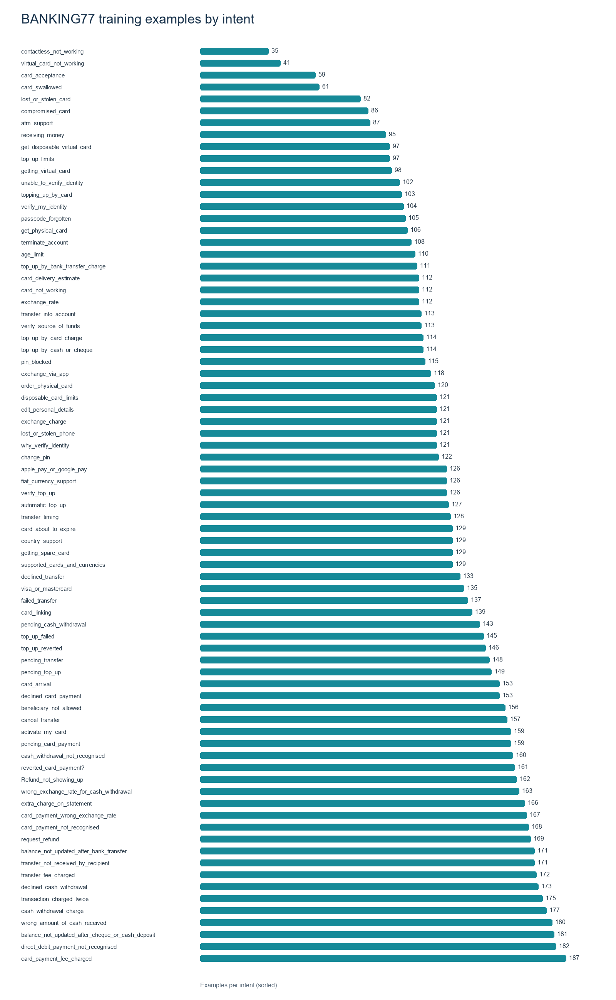

# Этап 1. Исследование проекта

## Решение

Для первой учебной задачи выбираем **BANKING77** как основной кандидат на классификацию намерений обращений. Он содержит 13 083 англоязычных банковских запроса с 77 мелкозернистыми классами и опубликованным разбиением 10 003 train / 3 080 test. Обучающую часть разделим на train/validation, а исходный test сохраним закрытым до финального сравнения моделей. Перед обучением проверим фактические данные и дубликаты.

Это учебная постановка intent classification, а не готовая система поддержки. Датасет не содержит меток срочности, статей базы знаний, истории диалогов или эталонных ответов. Их нельзя честно получить из метки намерения; для этих функций понадобятся отдельные источники/аннотации и отдельная оценка.

## 1. Где искали и что сравнили

| Набор | Содержание и масштаб по карточке/публикации | Сильные стороны | Ограничения для нашего проекта |
|---|---|---|---|
| BANKING77 | 13 083 запроса, 77 банковских намерений; официальный split: 10 003 train и 3 080 test | Фокус на поддержке, детальные близкие классы, удобно сравнивать классические модели и трансформеры; исходная работа и данные доступны | Только английский и банковский домен; одна метка на запрос; нет приоритета, ответов, базы знаний или диалогового контекста |
| CLINC150 / OOS | 23 700 запросов: 22 500 in-scope по 150 намерениям и out-of-scope примеры; предложен для классификации намерений и распознавания запросов вне области | Полезен для отдельного эксперимента по отказу/неизвестному намерению | Не специализирован на поддержке; множество классов, которые могут быть менее близки к нашему домену; OOS лучше оставить отдельной проверкой после базового этапа |
| MASSIVE | Более 1 млн высказываний, 52 языка, 18 доменов, 60 намерений и 55 типов слотов | Большой многоязычный корпус для переноса между языками и slot filling | Задача виртуального ассистента шире поддержки; объём и множество языков повышают сложность первого этапа |
| Bitext Customer Support | 26 872 пары вопрос/ответ, 27 намерений и 10 категорий; синтетические данные, созданные гибридным способом | Близко к службе поддержки; имеются ответы для исследований генерации | Синтетическая природа и возможные шаблонные формулировки упрощают задачу и могут завысить переносимость на реальные обращения; домены смешаны |

## 2. Почему начнём с BANKING77

Выбор соответствует учебной цели: освоить классификацию коротких запросов с большим числом семантически близких классов. Это делает сравнение majority baseline, TF-IDF с Logistic Regression / Linear SVM / Naive Bayes, затем Transformer содержательным. Официальный test split обеспечивает фиксированную конечную проверку; validation выделим только из train. Перед любым разделением проверим точные и нормализованные дубликаты и документируем, как поступаем с повторами, чтобы похожие тексты не давали чрезмерно оптимистичную оценку.

Первичный EDA локальной копии подтвердил ожидаемую схему и отсутствие пропусков. Он также показал вариацию частоты train-классов, правый хвост длины и небольшое число совпадений после нормализации между split. Близкие по смыслу формулировки ещё не проверялись. Эти результаты сохраняют BANKING77 подходящим стартовым benchmark при описанных ограничениях.

## 3. Формализация первой ML-задачи

- **Тип:** supervised single-label multiclass classification.
- **Вход:** текст одного пользовательского запроса на английском.
- **Цель:** одна из 77 меток намерения BANKING77.
- **Выход приложения на первом этапе:** предсказанный intent и оценка уверенности; политика порога и abstain будет отдельным решением.
- **Основной критерий сравнения:** Macro F1 на validation, поскольку он даёт равный вес каждому классу. Дополнительно покажем accuracy, per-class precision/recall/F1, weighted F1 и confusion matrix. Test используем один раз после выбора.
- **Граница:** метка intent не является приоритетом/срочностью. Приоритет требует размеченных примеров и определения бизнес-критериев.

## 4. Первичная архитектура

```text
Исследование данных → версионируемая подготовка → baseline и эксперименты
                                               ↓
                                  сохранение модели и метрик
                                               ↓
Пользователь → FastAPI → intent classifier ──────→ ответ с intent/уверенностью
                              │
                              └→ будущие этапы: retrieval → reranker → RAG → разрешённые tools

MLflow (конфигурации и метрики) + тесты + Docker + мониторинг качества/дрейфа
```

Слои `rag/` и `agents/` создаются в структуре как будущие этапы, но не реализуются сейчас. Агент будет ограничен явными инструментами и политиками авторизации; классификатор сам по себе не выполняет действия.

## 5. План этапов и экспериментов

1. **Исследование и постановка:** датасеты, выбор, архитектура и начальный учебный документ. Текущий этап.
2. **Загрузка и EDA — завершено:** зафиксированы источник/checksum; проверены схема, распределение, пропуски, повторы и пересечения; построены графики и обновлён Word.
3. **Разбиение и baseline:** validation из train со стратификацией; Majority, TF-IDF + Logistic Regression, Linear SVM, Naive Bayes; единый evaluation pipeline.
4. **Анализ ошибок и классические эксперименты:** только гипотезы с зафиксированными конфигурациями: n-граммы/параметры TF-IDF, class weights, предобработка и длина. Test не использовать для выбора.
5. **Transformer:** DistilBERT и, если ресурсы позволяют, BERT; сравнить качество, задержку, размер и память; zero/few-shot рассматривать отдельно с учётом стоимости и условий доступа.
6. **Финальный выбор:** единственный финальный test-прогон и документированное решение по качеству/скорости/ресурсам.
7. **Продуктовые возможности отдельными данными:** приоритеты, поиск похожих обращений, база знаний/RAG, ответы, API и агентные инструменты. Не смешивать их метрики с intent classification.
8. **Упаковка и эксплуатация:** FastAPI, Docker, MLflow, мониторинг и оценка изменений.

Каждая гипотеза записывается до запуска: базовый вариант, изменение, метрика, результаты, интерпретация и решение оставить/отклонить. До выполнения эксперимента метрики не подставляются.

## 6. Риски и ограничения

- **Domain/language shift:** английские банковские короткие запросы не представляют произвольные русскоязычные обращения.
- **Label ambiguity:** соседние банковские намерения могут пересекаться; смотреть confusion matrix и примеры ошибок.
- **Split leakage:** дубли/почти дубли между train и test могут завысить оценку; аудит точных и нормализованных совпадений уже выполнен; семантические near-duplicates требуют отдельного исследования.
- **Benchmark leakage:** открытый benchmark мог встречаться в обучающих корпусах моделей; особенно учитывать при интерпретации zero-shot/few-shot и предобученных LLM.
- **Coverage:** все примеры датасета имеют известную метку, тогда как в продакшене встречаются новые/неподдерживаемые запросы.
- **Synthetic data:** Bitext может содержать шаблонность и не гарантирует качество на реальных обращениях.
- **License:** у BANKING77 указана CC BY 4.0; при распространении данных/производных материалов сохранять атрибуцию и ссылку на лицензию.

## 7. Начальная структура проекта

- `data/raw/`, `data/processed/`
- `notebooks/`
- `src/data/`, `src/features/`, `src/models/`, `src/evaluation/`, `src/rag/`, `src/agents/`, `src/api/`
- `experiments/`, `reports/`, `tests/`, `configs/`, `docs/`

## Источники

1. Casanueva et al. (2020), *Efficient Intent Detection with Dual Sentence Encoders*, ACL Workshop: https://aclanthology.org/2020.nlp4convai-1.5/ и статья https://arxiv.org/abs/2003.04807
2. PolyAI BANKING77 dataset card: https://huggingface.co/datasets/PolyAI/banking77
3. Исходный репозиторий и лицензия CC BY 4.0: https://github.com/PolyAI-LDN/task-specific-datasets
4. Larson et al. (2019), CLINC OOS: https://aclanthology.org/D19-1131/
5. Amazon MASSIVE dataset card: https://huggingface.co/datasets/AmazonScience/massive
6. Bitext Customer Support dataset card: https://huggingface.co/datasets/bitext/Bitext-customer-support-llm-chatbot-training-dataset

---

**Вывод этапа 1:** BANKING77 выбран как подходящий benchmark для intent classification при сохранении его границ. Фактический EDA и полученные ограничения зафиксированы в разделе «Результаты этапа 2». Следующий шаг — подготовить train/validation без использования test при подборе и построить классические baseline.
## Результаты этапа 2 — первичный EDA

### Источник и воспроизводимость

13 ноября 2026 года загружены CSV `train.csv` и `test.csv` из официального репозитория PolyAI. Оригинальные файлы оставлены вне Git; `data/raw/source_manifest.json` хранит источник, лицензию, размер, ожидаемое число строк и SHA-256 для проверки неизменности. Скрипт `src/data/eda.py` читает исходные CSV, проверяет схему и пишет машинно-читаемую сводку в `reports/eda_summary.json` и графики в `reports/figures/`.

| Split | Записей | Классов | Пропуски | Примеры на класс |
|---|---:|---:|---:|---:|
| Train | 10 003 | 77 | 0 | 35–187, медиана 127 |
| Test | 3 080 | 77 | 0 | ровно 40 в каждом классе |

Исходные признаки — `text` и `category`; отдельного ID, временной метки, приоритета или контекста обращения нет. В train-срезе распределение неодинаково: максимальный класс примерно в 5,3 раза больше минимального. Это умеренное, но заметное различие, поэтому основной метрикой оставляем Macro F1 и всегда показываем метрики по классам. Официальный test сбалансирован: при одинаковой поддержке каждого класса Macro F1 и Weighted F1 будут совпадать на этом split; это свойство данного test, а не универсальное правило. Accuracy при этом не обязана совпадать с F1.

### Длина текста

| Split | Медиана символов | 75-й процентиль | 95-й процентиль | Максимум |
|---|---:|---:|---:|---:|
| Train | 47 | 64 | 152 | 433 |
| Test | 45 | 60 | 124 | 368 |

Распределение длины имеет выраженный правый хвост: большинство запросов короткие, но есть более длинные примеры. Поэтому не будем заранее отрезать текст по средней длине. Для Transformer отдельно измерим длины в токенах обучающего токенизатора, прежде чем выбирать `max_length`.



*Рисунок 1. Число примеров каждого intent в train, классы отсортированы по частоте.*


*Рисунок 2. Длина текста в символах; заметен правый хвост.*

### Пропуски, повторы и возможная утечка

- Пропусков в `text` и `category` не найдено.
- Полных повторов текста внутри train или test нет.
- При аудиторской нормализации (casefold и схлопывание пробелов; исходный текст не меняется) найдено 8 train-строк, соответствующих 4 повторяющимся ключам, и 2 test-строки с 1 ключом.
- Между train и test нет точных совпадений текста. Есть 7 нормализованных ключей, представленных по одной строке в каждой выборке; конфликтов меток у этих совпадений нет.

Даже совпадения только по регистру или пробелам могут слегка завысить оценку. Перед созданием validation удалим повторные train-примеры внутри train и строки train, совпадающие с официальным test по аудиторскому ключу. Test останется без изменений; этот шаг зафиксируем до обучения. Проверка близких по смыслу, но не идентичных текстов потребует отдельного анализа ошибок и не покрывается exact/normalized duplicate audit.

### Что меняется в плане

1. Для validation используем стратифицированное разбиение исходной обучающей части после оговорённой дедупликации; официальный test не используем для подбора.
2. Из-за разного числа train-примеров на класс Macro F1 особенно информативен; добавим per-class recall и support.
3. Не вводим агрессивную очистку: правописание, пунктуация и регистр могут нести сигнал; сравним минимальную обработку с вариантами позже как отдельные эксперименты.
4. Графики и сводка воспроизводятся скриптом; численные результаты этого раздела получены на локальных загруженных CSV, а не перенесены из чужих экспериментов.

**Вывод:** схема чистая, классы представлены неравномерно в train, запросы обычно короткие, а аудит выявил 7 нормализованных совпадений между split. Следующий этап — аккуратно подготовить train/validation и построить простые baseline-модели; test сохраняем для финальной оценки.
