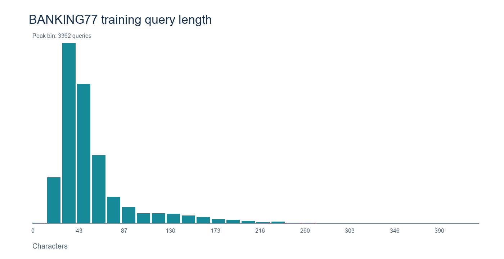

# Этап 1. Исследование проекта

## Решение

Для первой учебной задачи выбираем **BANKING77** как основной кандидат на классификацию намерений обращений. Он содержит 13 083 англоязычных банковских запроса с 77 мелкозернистыми классами и опубликованным разбиением 10 003 train / 3 080 test. Обучающую часть разделим на train/validation, а исходный test сохраним закрытым до финального сравнения моделей. Перед обучением проверим фактические данные и дубликаты.

Это учебная постановка intent classification, а не готовая система поддержки. Датасет не содержит меток срочности, статей базы знаний, истории диалогов или эталонных ответов. Их нельзя честно получить из метки намерения; для этих функций понадобятся отдельные источники/аннотации и отдельная оценка.

## 1. Где искали и что сравнили

| Набор | Содержание и масштаб по карточке/публикации | Сильные стороны | Ограничения для нашего проекта |
|---|---|---|---|
| BANKING77 | 13 083 запроса, 77 банковских намерений; официальный split: 10 003 train и 3 080 test | Фокус на поддержке, детальные близкие классы, удобно сравнивать классические модели и трансформеры; исходная работа и данные доступны | Только английский и банковский домен; одна метка на запрос; нет приоритета, ответов, базы знаний или диалогового контекста |
| CLINC150 / OOS | 23 700 запросов: 22 500 in-scope по 150 намерениям и out-of-scope примеры; предложен для классификации намерений и распознавания запросов вне области | Полезен для отдельного эксперимента по отказу/неизвестному намерению | Не специализирован на поддержке; множество классов, которые могут быть менее близки к нашему домену; OOS лучше оставить отдельной проверкой после базового этапа |
| MASSIVE | Более 1 млн высказываний, 52 языка, 18 доменов, 60 намерений и 55 типов слотов | Большой многоязычный корпус для переноса между языками и slot filling | Задача виртуального ассистента шире поддержки; объём и множество языков повышают сложность первого этапа |
| Bitext Customer Support | 26 872 пары вопрос/ответ, 27 намерений и 10 категорий; синтетические данные, созданные гибридным способом | Близко к службе поддержки; имеются ответы для исследований генерации | Синтетическая природа и возможные шаблонные формулировки упрощают задачу и могут завысить переносимость на реальные обращения; домены смешаны |

## 2. Почему начнём с BANKING77

Выбор соответствует учебной цели: освоить классификацию коротких запросов с большим числом семантически близких классов. Это делает сравнение majority baseline, TF-IDF с Logistic Regression / Linear SVM / Naive Bayes, затем Transformer содержательным. Официальный test split обеспечивает фиксированную конечную проверку; validation выделим только из train. Перед любым разделением проверим точные и нормализованные дубликаты и документируем, как поступаем с повторами, чтобы похожие тексты не давали чрезмерно оптимистичную оценку.

Первичный EDA локальной копии подтвердил ожидаемую схему и отсутствие пропусков. Он также показал вариацию частоты train-классов, правый хвост длины и небольшое число совпадений после нормализации между split. Близкие по смыслу формулировки ещё не проверялись. Эти результаты сохраняют BANKING77 подходящим стартовым benchmark при описанных ограничениях.

## 3. Формализация первой ML-задачи

- **Тип:** supervised single-label multiclass classification.
- **Вход:** текст одного пользовательского запроса на английском.
- **Цель:** одна из 77 меток намерения BANKING77.
- **Выход приложения на первом этапе:** предсказанный intent и оценка уверенности; политика порога и abstain будет отдельным решением.
- **Основной критерий сравнения:** Macro F1 на validation, поскольку он даёт равный вес каждому классу. Дополнительно покажем accuracy, per-class precision/recall/F1, weighted F1 и confusion matrix. Test используем один раз после выбора.
- **Граница:** метка intent не является приоритетом/срочностью. Приоритет требует размеченных примеров и определения бизнес-критериев.

## 4. Первичная архитектура

```text
Исследование данных → версионируемая подготовка → baseline и эксперименты
                                               ↓
                                  сохранение модели и метрик
                                               ↓
Пользователь → FastAPI → intent classifier ──────→ ответ с intent/уверенностью
                              │
                              └→ будущие этапы: retrieval → reranker → RAG → разрешённые tools

MLflow (конфигурации и метрики) + тесты + Docker + мониторинг качества/дрейфа
```

Слои `rag/` и `agents/` создаются в структуре как будущие этапы, но не реализуются сейчас. Агент будет ограничен явными инструментами и политиками авторизации; классификатор сам по себе не выполняет действия.

## 5. План этапов и экспериментов

1. **Исследование и постановка:** датасеты, выбор, архитектура и начальный учебный документ. Текущий этап.
2. **Загрузка и EDA — завершено:** зафиксированы источник/checksum; проверены схема, распределение, пропуски, повторы и пересечения; построены графики и обновлён Word.
3. **Разбиение и baseline:** validation из train со стратификацией; Majority, TF-IDF + Logistic Regression, Linear SVM, Naive Bayes; единый evaluation pipeline.
4. **Анализ ошибок и классические эксперименты:** только гипотезы с зафиксированными конфигурациями: n-граммы/параметры TF-IDF, class weights, предобработка и длина. Test не использовать для выбора.
5. **Transformer:** DistilBERT и, если ресурсы позволяют, BERT; сравнить качество, задержку, размер и память; zero/few-shot рассматривать отдельно с учётом стоимости и условий доступа.
6. **Финальный выбор:** единственный финальный test-прогон и документированное решение по качеству/скорости/ресурсам.
7. **Продуктовые возможности отдельными данными:** приоритеты, поиск похожих обращений, база знаний/RAG, ответы, API и агентные инструменты. Не смешивать их метрики с intent classification.
8. **Упаковка и эксплуатация:** FastAPI, Docker, MLflow, мониторинг и оценка изменений.

Каждая гипотеза записывается до запуска: базовый вариант, изменение, метрика, результаты, интерпретация и решение оставить/отклонить. До выполнения эксперимента метрики не подставляются.

## 6. Риски и ограничения

- **Domain/language shift:** английские банковские короткие запросы не представляют произвольные русскоязычные обращения.
- **Label ambiguity:** соседние банковские намерения могут пересекаться; смотреть confusion matrix и примеры ошибок.
- **Split leakage:** дубли/почти дубли между train и test могут завысить оценку; аудит точных и нормализованных совпадений уже выполнен; семантические near-duplicates требуют отдельного исследования.
- **Benchmark leakage:** открытый benchmark мог встречаться в обучающих корпусах моделей; особенно учитывать при интерпретации zero-shot/few-shot и предобученных LLM.
- **Coverage:** все примеры датасета имеют известную метку, тогда как в продакшене встречаются новые/неподдерживаемые запросы.
- **Synthetic data:** Bitext может содержать шаблонность и не гарантирует качество на реальных обращениях.
- **License:** у BANKING77 указана CC BY 4.0; при распространении данных/производных материалов сохранять атрибуцию и ссылку на лицензию.

## 7. Начальная структура проекта

- `data/raw/`, `data/processed/`
- `notebooks/`
- `src/data/`, `src/features/`, `src/models/`, `src/evaluation/`, `src/rag/`, `src/agents/`, `src/api/`
- `experiments/`, `reports/`, `tests/`, `configs/`, `docs/`

## Источники

1. Casanueva et al. (2020), *Efficient Intent Detection with Dual Sentence Encoders*, ACL Workshop: https://aclanthology.org/2020.nlp4convai-1.5/ и статья https://arxiv.org/abs/2003.04807
2. PolyAI BANKING77 dataset card: https://huggingface.co/datasets/PolyAI/banking77
3. Исходный репозиторий и лицензия CC BY 4.0: https://github.com/PolyAI-LDN/task-specific-datasets
4. Larson et al. (2019), CLINC OOS: https://aclanthology.org/D19-1131/
5. Amazon MASSIVE dataset card: https://huggingface.co/datasets/AmazonScience/massive
6. Bitext Customer Support dataset card: https://huggingface.co/datasets/bitext/Bitext-customer-support-llm-chatbot-training-dataset

---

**Вывод этапа 1:** BANKING77 выбран как подходящий benchmark для intent classification при сохранении его границ. Фактический EDA и полученные ограничения зафиксированы в разделе «Результаты этапа 2». Следующий шаг — подготовить train/validation без использования test при подборе и построить классические baseline.
## Результаты этапа 2 — первичный EDA

### Источник и воспроизводимость

13 ноября 2026 года загружены CSV `train.csv` и `test.csv` из официального репозитория PolyAI. Оригинальные файлы оставлены вне Git; `data/raw/source_manifest.json` хранит источник, лицензию, размер, ожидаемое число строк и SHA-256 для проверки неизменности. Скрипт `src/data/eda.py` читает исходные CSV, проверяет схему и пишет машинно-читаемую сводку в `reports/eda_summary.json` и графики в `reports/figures/`.

| Split | Записей | Классов | Пропуски | Примеры на класс |
|---|---:|---:|---:|---:|
| Train | 10 003 | 77 | 0 | 35–187, медиана 127 |
| Test | 3 080 | 77 | 0 | ровно 40 в каждом классе |

Исходные признаки — `text` и `category`; отдельного ID, временной метки, приоритета или контекста обращения нет. В train-срезе распределение неодинаково: максимальный класс примерно в 5,3 раза больше минимального. Это умеренное, но заметное различие, поэтому основной метрикой оставляем Macro F1 и всегда показываем метрики по классам. Официальный test сбалансирован: при одинаковой поддержке каждого класса Macro F1 и Weighted F1 будут совпадать на этом split; это свойство данного test, а не универсальное правило. Accuracy при этом не обязана совпадать с F1.

### Длина текста

| Split | Медиана символов | 75-й процентиль | 95-й процентиль | Максимум |
|---|---:|---:|---:|---:|
| Train | 47 | 64 | 152 | 433 |
| Test | 45 | 60 | 124 | 368 |

Распределение длины имеет выраженный правый хвост: большинство запросов короткие, но есть более длинные примеры. Поэтому не будем заранее отрезать текст по средней длине. Для Transformer отдельно измерим длины в токенах обучающего токенизатора, прежде чем выбирать `max_length`.


*Рисунок 1. Число примеров каждого intent в train, классы отсортированы по частоте.*



*Рисунок 2. Длина текста в символах; заметен правый хвост.*

### Пропуски, повторы и возможная утечка

- Пропусков в `text` и `category` не найдено.
- Полных повторов текста внутри train или test нет.
- При аудиторской нормализации (casefold и схлопывание пробелов; исходный текст не меняется) найдено 8 train-строк, соответствующих 4 повторяющимся ключам, и 2 test-строки с 1 ключом.
- Между train и test нет точных совпадений текста. Есть 7 нормализованных ключей, представленных по одной строке в каждой выборке; конфликтов меток у этих совпадений нет.

Даже совпадения только по регистру или пробелам могут слегка завысить оценку. Перед созданием validation удалим повторные train-примеры внутри train и строки train, совпадающие с официальным test по аудиторскому ключу. Test останется без изменений; этот шаг зафиксируем до обучения. Проверка близких по смыслу, но не идентичных текстов потребует отдельного анализа ошибок и не покрывается exact/normalized duplicate audit.

### Что меняется в плане

1. Для validation используем стратифицированное разбиение исходной обучающей части после оговорённой дедупликации; официальный test не используем для подбора.
2. Из-за разного числа train-примеров на класс Macro F1 особенно информативен; добавим per-class recall и support.
3. Не вводим агрессивную очистку: правописание, пунктуация и регистр могут нести сигнал; сравним минимальную обработку с вариантами позже как отдельные эксперименты.
4. Графики и сводка воспроизводятся скриптом; численные результаты этого раздела получены на локальных загруженных CSV, а не перенесены из чужих экспериментов.

**Вывод:** схема чистая, классы представлены неравномерно в train, запросы обычно короткие, а аудит выявил 7 нормализованных совпадений между split. Результаты очистки, разбиения и baseline приведены в разделе «Результаты этапа 3» ниже; официальный test остаётся для финальной оценки.

## Результаты этапа 3 — разбиение и classical baseline

### Разбиение без пересечения формулировок

Сначала оставили по одной строке на нормализованный текст внутри source train (удалено 4 строки), затем исключили из train 7 нормализованных текстов, присутствовавших в official test. Удаление выполнялось только со стороны train; официальный test файл остался байт-в-байт тем же. Тексты test использовались для аудита дубликатов, но метки и оценки на test не использовались при обучении или выборе модели.

Из 9 992 оставшихся примеров сделали стратифицированное разбиение с `random_state=42`: 7 993 train и 1 999 validation. Все 77 намерений есть в обеих частях; support составляет 28–149 в train и 7–38 в validation. TF-IDF обучается внутри `sklearn.Pipeline` только на train.

### Сопоставление моделей на validation

| Модель | Accuracy | Macro Precision | Macro Recall | Macro F1 | Weighted Precision | Weighted Recall | Weighted F1 |
|---|---:|---:|---:|---:|---:|---:|---:|
| tfidf_linear_svm | 0.8789 | 0.8870 | 0.8776 | 0.8795 | 0.8836 | 0.8789 | 0.8786 |
| tfidf_logistic_regression | 0.8469 | 0.8627 | 0.8339 | 0.8395 | 0.8553 | 0.8469 | 0.8454 |
| tfidf_multinomial_nb | 0.7989 | 0.8032 | 0.7610 | 0.7632 | 0.8119 | 0.7989 | 0.7901 |
| majority | 0.0190 | 0.0002 | 0.0130 | 0.0005 | 0.0004 | 0.0190 | 0.0007 |

В конфигурации `configs/baseline.json` зафиксированы общие TF-IDF настройки: word n-граммы 1–2, lowercase, min_df=1, sublinear_tf, без stop-word фильтра и без class weights. Модели: Logistic Regression C=1/max_iter=2000; LinearSVC C=1; MultinomialNB alpha=1; Majority предсказывает наиболее частый класс.

### Скорость и размер артефакта

| Модель | Fit, сек | Одиночный predict P50 / P95, мс | Сериализованный pipeline, MB |
|---|---:|---:|---:|
| tfidf_linear_svm | 0.53 | 0.45 / 0.82 | 12.69 |
| tfidf_logistic_regression | 9.50 | 0.44 / 0.72 | 12.69 |
| tfidf_multinomial_nb | 0.19 | 4.69 / 5.84 | 24.91 |
| majority | 0.02 | 0.02 / 0.03 | 0.00 |

Одиночный estimator `predict` измерялся на 200 validation запросах с пятью повторами. Эти значения не включают HTTP/API overhead и зависят от компьютера и библиотек. Joblib — размер сериализованного pipeline, не объём RAM; пиковую память процесса в этой среде не измеряли.

### Интерпретация метрик

Linear SVM достиг Accuracy=0.8789 и Macro F1=0.8795 на 1 999 validation запросах. Accuracy означает, что около 87,9% запросов получили верную метку. Macro F1 — среднее F1 по 77 классам с одинаковым весом, поэтому отражает и редкие intents. Weighted F1=0.8786 взвешивает классы по support. Их близость показывает результат этого stratified validation, но метрики не взаимозаменяемы.

Для класса k: `Precision_k = TP_k / (TP_k + FP_k)`, `Recall_k = TP_k / (TP_k + FN_k)`, `F1_k = 2 × Precision_k × Recall_k / (Precision_k + Recall_k)`. `Accuracy = правильные предсказания / N`; `Macro F1 = (Σ F1_k) / K`; `Weighted F1 = Σ (support_k × F1_k) / N`. Macro Precision/Recall также усредняют классы поровну, Weighted Precision/Recall взвешивают support.

Majority получил 1,9% accuracy и Macro F1 около 0.0005, подтвердив нижнюю контрольную планку. Logistic Regression достиг Macro F1=0.8395, Naive Bayes — 0.7632. Linear SVM — лучший классический baseline этого этапа, но ещё не финальная модель: использованы один фиксированный split и базовые гиперпараметры, class weights не проверялись, Transformer не сравнивался. Official test пока не запускался.

ROC-AUC не считали: цель — 77-классовое назначение одного intent, а LinearSVC даёт margin scores, не откалиброванные вероятности. One-vs-rest ROC-AUC можно добавить отдельной гипотезой, если ranking качества станет важен.

### Разбор ошибок

Наиболее частые пары ошибок Linear SVM: `top_up_failed` → `pending_top_up` (5), `disposable_card_limits` → `get_disposable_virtual_card` (5), `pending_transfer` → `pending_card_payment` (4), `pending_transfer` → `transfer_not_received_by_recipient` (4). У `pending_transfer` F1=0.704 при support=30; у `top_up_failed` F1=0.731 при support=29. Общий Macro F1 поэтому скрывает слабые отдельные классы. Ошибки на некоторых примерах также требуют проверки неоднозначности исходной формулировки или разметки, не только смены алгоритма.

Матрица ошибок Linear SVM: `experiments/baseline/tfidf_linear_svm_confusion_matrix.png`; все CSV matrices, per-class отчёты, топ путаниц и тексты ошибочных предсказаний сохранены рядом. MLflow Tracking сохраняет параметры, метрики и артефакты запусков. Метаданные находятся в локальной SQLite, файлы артефактов — в `mlruns/`, оба исключены из Git. Официальная документация описывает [логирование параметров, метрик и артефактов](https://mlflow.org/docs/latest/tracking/tracking-api/) и [SQLite как database backend](https://mlflow.org/docs/latest/tracking/backend-stores/).

**Вывод:** TF-IDF + Linear SVM даёт сильную базовую точку по Macro F1. Подбор словесных n-грамм, `C` и class weights описан ниже; оценка проведена на той же validation без обращения к official test.

## Сравнение настроек Linear SVM

Проверили 18 комбинаций: диапазон словесных n-грамм `(1,1)`, `(1,2)` и `(1,3)`; `C` из `{0.5, 1, 2}`; `class_weight` из `{None, balanced}`. Для всех вариантов сохранены одинаковые train/validation, TF-IDF параметры, метрики по классам и MLflow run. Главный критерий сравнения — Macro F1.

| Ранг | TF-IDF n-граммы | C | Веса классов | Accuracy | Macro F1 |
|---:|---|---:|---|---:|---:|
| 1 | 1–2 | 1 | None | 0.8789 | 0.8795 |
| 2 | 1–2 | 2 | None | 0.8774 | 0.8793 |
| 3 | 1 | 2 | balanced | 0.8784 | 0.8765 |
| 4 | 1–2 | 2 | balanced | 0.8764 | 0.8763 |
| 5 | 1–2 | 1 | balanced | 0.8759 | 0.8751 |

Лучший вариант совпал с исходной настройкой baseline `(1,2), C=1, class_weight=None`: Macro F1 остался 0.8795. Увеличение `C` до 2 дало 0.8793, то есть небольшое снижение на 0.0002. Добавление триграмм снизило лучший результат до 0.8653; конфигурации с `class_weight='balanced'` не дали общего улучшения. Поэтому текущую настройку сохраняем как classical baseline. Подбор не дал оснований усложнять эту модель.

Полная таблица 18 конфигураций находится в `experiments/baseline/linear_svm_tuning_results.csv`, отчёты по классам — в `experiments/baseline/tuning_reports/`. Сводные метрики baseline и настройки находятся в `experiments/baseline/notebook_results.csv`; параметры, метрики, модели и отчёты запусков залогированы в локальном MLflow.

Official test не использовался для выбора параметров.

## Сравнение словесных и символьных n-грамм

После подбора Linear SVM проверили, может ли символьное представление улучшить результат. Сравнили 7 вариантов: `char_wb` с n-граммами 3–5 и тремя значениями `C`; `char` с тем же диапазоном и `C=1`; объединение word TF-IDF (1–2) и `char_wb` (3–5) с тремя значениями `C`. Для символьных векторизаторов использовали `min_df=2`, `class_weight=None`. Разбиение, train и validation не менялись.

| Представление | C | Accuracy | Macro F1 | Fit, сек |
|---|---:|---:|---:|---:|
| Word (1–2) + char_wb (3–5) | 2 | 0.8974 | 0.8987 | 3.86 |
| Word (1–2) + char_wb (3–5) | 1 | 0.8974 | 0.8986 | 2.74 |
| Word (1–2) + char_wb (3–5) | 0.5 | 0.8984 | 0.8975 | 2.69 |
| Char (3–5) | 1 | 0.8959 | 0.8954 | 3.63 |
| Char_wb (3–5) | 1 | 0.8919 | 0.8921 | 1.83 |
| Word baseline (1–2) | 1 | 0.8789 | 0.8795 | 0.56 |

Объединённые word + char_wb n-граммы с `C=2` дали лучший Macro F1 — 0.8987, прирост 0.0192 относительно исходного SVM; Accuracy выросла на 0.0185. Это улучшение на текущей validation, а не финальная оценка на новых данных. Fit занял 3.86 сек вместо 0.56 сек; задержку predict и память этой конфигурации ещё не измеряли.

Выбираем combined word + char_wb с `C=2` как текущего кандидата на финальную оценку. `C=1` почти не уступил по Macro F1 (разница 0.0001) и обучился быстрее; перед выводом о скорости нужно повторить замеры несколько раз на одном компьютере. Отдельный char и char_wb тоже превзошли word baseline, но уступили объединённому представлению.

Полная таблица сохранена в `experiments/baseline/word_char_comparison.csv`, отчёты по классам — в `experiments/baseline/character_tuning_reports/`. Наиболее частые ошибки лучшей combined-модели и матрица сохранены как `notebook_top_confusions.csv` и `notebook_best_model_confusion_matrix.png`. Official test пока не использован.

## Фиксация кандидата и эксплуатационные замеры

Кандидат зафиксирован в `configs/final_model.json`: Linear SVM с `C=2`, word TF-IDF (1–2) и char_wb TF-IDF (3–5), `min_df=2` для char-вектора, без class weights. Выбор основан на Macro F1=0.8987 validation. Параметры более не меняются по official test.

На текущем компьютере измерили одиночный `predict` на 200 validation-запросах в 10 повторениях после 32 прогревочных запросов. P50 составил 1.21 мс, P95 — 2.20 мс. Пять полных пакетных прогонов по 1 999 validation-запросам дали медиану 0.185 сек, около 10 791 запроса в секунду при пакетном вызове. Fit занял 3.86 сек в одном прогоне. Сериализованный pipeline занимает 20.36 MiB. Эти замеры зависят от оборудования и версий Python/scikit-learn; одиночная задержка не включает HTTP/API overhead, пиковую RAM не измеряли.

Метрики замеров сохранены в `experiments/final_model/operational_metrics.json` и залогированы в MLflow.

## Однократная финальная оценка

После фиксации кандидата проверили SHA-256 official test по манифесту источника и запустили предсказания один раз. В выборке 3 080 запросов, ровно по 40 на каждый из 77 классов. В `configs/final_model.json` отмечено, что official test использован; последующие запуски notebook показывают сохранённые метрики и не вызывают предсказание повторно.

| Выборка | Строки | Accuracy | Macro Precision | Macro Recall | Macro F1 | Weighted F1 |
|---|---:|---:|---:|---:|---:|---:|
| Validation | 1 999 | 0.8974 | 0.9036 | 0.8977 | 0.8987 | 0.8971 |
| Official test | 3 080 | 0.9010 | 0.9039 | 0.9010 | 0.9011 | 0.9011 |

Test Macro F1 выше validation на 0.0024. На равномерном test macro и weighted средние совпадают или почти совпадают, потому что в каждом классе одинаковый support. Результат служит финальной оценкой этого кандидата; после просмотра метрик параметры не меняли.

Самые частые отдельные путаницы на test встречались по 4 раза: `unable_to_verify_identity` → `why_verify_identity`, `unable_to_verify_identity` → `verify_my_identity`, `card_arrival` → `card_delivery_estimate`, `balance_not_updated_after_bank_transfer` → `pending_transfer`. Самый низкий F1 у `balance_not_updated_after_bank_transfer` — 0.725 при 40 примерах; эти ошибки документированы, но не используются для дополнительной настройки по уже просмотренному test.

Итоговые метрики, per-class отчёт и confusion matrix сохранены в `experiments/final_model/`; run помечен `official_test` в MLflow. Official test не используется для дальнейшей настройки.

## HTTP API для классификации

После оценки обернули зафиксированный pipeline в локальный FastAPI сервис (`src/api/main.py`). Модель читается из joblib артефакта один раз при запуске и сохраняется в application state, чтобы не загружать её для каждого запроса. Путь берётся из `configs/final_model.json`; `INTENT_MODEL_PATH` нужен для локального переопределения при запуске другого артефакта.

`POST /v1/classify` принимает JSON с `text`, валидирует тип и длину (1–2 000 символов), обрезает крайние пробелы и отклоняет дополнительные поля. Ответ содержит только `intent`, `request_id` и `model_version`. Confidence не включён: `LinearSVC` не калибровался в вероятности. `/health/live` сообщает, что процесс запущен; `/health/ready` проверяет доступность модели и отвечает 503 до появления артефакта. Текст обращения не попадает в журнальные сообщения приложения.

Локальный запуск: установить зависимости из `requirements.txt`, убедиться, что notebook создал `work/final_models/banking77_word_char_tfidf_linear_svm.joblib`, затем выполнить `python -m uvicorn src.api.main:app --reload`. Интерактивная схема запросов доступна на `/docs`. API принимает и классифицирует обращения, но пока не формирует ответы клиентам. Код проверен на синтаксис; запуск сервера и HTTP-запросы остаются отдельной проверкой.

### Решения и границы текущей реализации

| Решение | Причина | Текущая граница |
|---|---|---|
| Загружать pipeline один раз на lifespan приложения | Не повторять дисковый I/O на каждом запросе | Перезапуск процесса нужен при замене артефакта |
| Разделить liveness и readiness | Живой процесс может стартовать без model artifact | Readiness становится true только после загрузки модели |
| Не возвращать confidence | Decision scores LinearSVC не являются калиброванными вероятностями | Для вероятностей нужна отдельная калибровка и проверка на новых данных |
| Не сохранять raw text в логах | Снизить ненужное хранение содержимого обращения | Авторизация, rate limiting, метрики и аудит ещё не добавлены |
| Использовать только intent классификацию | BANKING77 не содержит базу знаний или эталонные ответы | Нужен проверенный корпус статей перед Retrieval/RAG |
| Загружать только доверенный joblib артефакт | joblib использует механизм сериализации Python | Не передавать путь к модели через недоверенный пользовательский ввод |

## Первый lexical retrieval для базы знаний

### Почему отделяем поиск от генерации

BANKING77 содержит короткие обращения и метки intent, но не содержит проверенных инструкций поддержки. Нельзя использовать пользовательские обращения как будто это ответы. Поэтому сначала реализован самостоятельный поиск по статьям и описан формат источников; генерация ответов не подключалась. Это позволяет отдельно проверить, находит ли система нужный документ, прежде чем добавлять генеративный компонент.

### Формат статей и контроль источников

Корпус ожидается в `data/knowledge/articles.jsonl`, UTF-8, один JSON-объект на строку. Обязательные поля: уникальный стабильный `id`, `title`, `content`, открываемый оператором `source`, `updated_at` и `language`. Загрузчик сообщает строку с ошибкой JSON, проверяет поля и уникальность ID. В корпус следует включать только утверждённые статьи с известным владельцем и правом использования; персональные данные, пароли и внутренние заметки исключаются. В репозитории пока нет самих статей, поэтому retrieval-метрики и примеры найденных ответов не заявляются.

### Разбиение и поиск

`src/rag/retriever.py` нормализует пробельные символы и делит текст на фрагменты длиной до 900 символов с перекрытием 120. Перекрытие помогает сохранить контекст на границе частей. Первый baseline — word TF-IDF с unigram и bigram: он прозрачен, не требует нового пакета и выдаёт совпадающие слова и фрагменты для ручной проверки. Векторизатор обучается только на корпусе статей; запрос преобразуется тем же словарём. Скалярное произведение L2-нормированных TF-IDF векторов используется как cosine similarity.

Добавлен второй лексический baseline — BM25 с unigram, параметрами k1=1.5 и b=0.75. Он учитывает частоту термина во фрагменте, редкость термина в корпусе и нормировку длины документа; это позволяет сравнить lexical ranking с TF-IDF без добавления зависимости. Параметры задаются при создании `BM25Retriever`. BM25 score и TF-IDF cosine similarity находятся в разных шкалах, поэтому нельзя сравнивать их численные значения напрямую. Для сравнения используйте Recall@5/MRR и отдельно настройте порог отказа для каждого метода. Равные оценки сортируются по стабильному chunk ID.

Результат включает идентификатор документа и фрагмента, заголовок, текст, источник, дату актуальности, язык и пару `score`/`score_type`. Это сырая величина ранжировщика; она не является вероятностью релевантности, уверенностью классификатора или гарантией корректного ответа. TF-IDF возвращает cosine similarity, BM25 — свой score. Сейчас нет порога, после которого ответ можно автоматически считать безопасным.

Пример вызова после появления корпуса:

```python
from src.rag.retriever import KnowledgeRetriever

retriever = KnowledgeRetriever.from_jsonl("data/knowledge/articles.jsonl")
hits = retriever.search("card payment reversed", top_k=5)
for hit in hits:
    print(hit.title, hit.source, hit.score, hit.score_type)
```

### Как будем оценивать

До решения о BM25, символьных признаках или эмбеддингах нужно подготовить отдельные `queries_calibration.jsonl` и `queries_holdout.jsonl`; строки содержат `query` и список `relevant_document_ids`. Сравнение методов и порога делается на calibration, финальные метрики фиксированного решения — только на holdout. Recall@5 — средняя доля размеченных релевантных статей среди первых пяти результатов, MRR — средний обратный ранг первого релевантного документа. В обоих наборах должны быть запросы разных намерений, вариантов формулировок, answerable и unanswerable примеры. Похожие переформулировки одного обращения нужно держать в одной части, чтобы не допустить утечки между группами.

После оценки lexical baseline можно сравнить его с BM25 или эмбеддингами на тех же запросах и фиксированных метках. Затем нужно определить правила для устаревших документов, отсутствия релевантного результата и передачи оператору. Генерация подключается позднее и должна ссылаться на найденные источники; качество поиска и качество сформулированного ответа оцениваются отдельно.

### Реализация оценки

`src/rag/evaluation.py` загружает любой из двух JSONL файлов, валидирует структуру и проверяет, что все релевантные ID действительно присутствуют в текущем индексе. Для каждого положительного запроса система ранжирует документы, а не фрагменты: если в top-5 попало несколько фрагментов одной статьи, статья занимает только одну позицию. Recall@5 — среднее по запросам число найденных уникальных релевантных документов в первых пяти, делённое на общее количество размеченных релевантных документов для запроса. MRR — среднее обратной позиции первой релевантной статьи. В результат также входят значения на каждый запрос, чтобы можно было найти ошибки и проверить разметку.

Запросы с пустым `relevant_document_ids` учитываются как unanswerable и не включаются в Recall@5 и MRR. Поиск всё равно выдаёт top-k кандидатов; без калибровки порога эти две метрики не отвечают, правильно ли система воздержалась. Для поведения отказа необходим отдельный анализ порогов и false positive на запросах без ответа. Метрики пока не рассчитаны, поскольку нет ни корпуса статей, ни экспертной выборки. Ноутбук показывает понятное сообщение, если файла разметки нет, а после его создания выводит сводку и таблицу по запросам.

### Исследование порога отказа

Добавлена `sweep_abstention_thresholds`: она перебирает значения score верхнего результата и считает, когда поиск принял бы запрос или воздержался. Принятый ответ считается поддержанным только если запрос размечен как answerable и top-1 документ указан среди релевантных. Таблица показывает coverage, precision/recall/F1 таких поддержанных ответов, unsafe accept rate (принятые запросы без релевантного top-1) и false accept rate для unanswerable запросов. Поскольку шкалы TF-IDF и BM25 разные, пороги подбираются отдельно для каждой модели. Это помогает понять компромисс: повышение порога обычно снижает coverage и может уменьшить небезопасные выдачи.

Score любого ранжировщика не является вероятностью. Порог выбирается только на калибровочном наборе с answerable и unanswerable запросами; затем его фиксируют и измеряют на отдельном holdout наборе. Порог нельзя выбирать по test-метрике и называть итоговый результат качеством, если на этих же примерах подбиралась настройка. До появления корпуса и таких двух выборок цифры намеренно не приводятся.

## HTTP API поиска по знаниям

Поиск опубликован отдельно от intent classification: `POST /v1/knowledge/search` принимает текст, `top_k` от 1 до 10 и необязательный язык, возвращает фрагменты и их source metadata. Endpoint не пишет текст запроса в журнал и не генерирует ответ. В ответе сохранены `score` и `score_type`, чтобы клиент не принимал BM25 score или TF-IDF similarity за вероятность. На текущем этапе результат предназначен для просмотра оператором/разработчиком, автоматическое принятие решения по score не включено.

Во время FastAPI lifespan индекс строится один раз из `data/knowledge/articles.jsonl`. `KNOWLEDGE_RETRIEVER` выбирает `tfidf` (default) или `bm25`, а `KNOWLEDGE_ARTICLES_PATH` переопределяет путь к корпусу. Если статьи отсутствуют или повреждены, приложение оставляет intent classification доступной, но `/health/knowledge/ready` и сам поиск возвращают 503. Это отделяет готовность двух функций и позволяет запускать классификационный сервис до подключения базы знаний. Индекс держится в памяти процесса; после обновления статей сервис нужно перезапустить.

HTTP smoke проверки этого endpoint не запускались: в проекте всё ещё отсутствует база знаний. Код проверяется статически; контракт маршрута виден в FastAPI `/docs` после запуска сервиса. Загрузка корпуса и ответы поиска отдельно контролируются readiness маршрутом базы знаний.

Для ручного HTTP взаимодействия добавлен `notebooks/03_api_search.ipynb`: он проверяет liveness, отдельно проверяет готовность корпуса и отправляет запрос стандартной библиотекой `urllib`, показывая источники и тип score. У него нет зависимости на requests. Ноутбук предназначен для разработчика и не является тестовым стендом: успешные результаты зависят от запущенного Uvicorn и реальных статей. На текущем этапе HTTP-запросы не отправлялись.

## Валидация и аудит корпуса знаний

### Контракт до индексации

Расширен формат статьи: помимо `id`, `title`, `content`, `source`, `updated_at` и `language`, обязательны `owner`, `license` и `status`. Дата приводится к одному формату ISO `YYYY-MM-DD`; в индекс проходят только статьи со `status="approved"`. Это фиксирует владельца, происхождение/разрешение и статус до того, как текст будет доступен поиску. Черновики, пустые метаданные, невалидные даты и повторные идентификаторы останавливают загрузку корпуса с номером строки.

### Аудитор

`src/rag/audit.py` строит сводку по числу статей, языкам, владельцам, лицензиям и длинам content. Он ищет дубликаты заголовков и содержимого после нормализации регистра и пробелов. Отдельный список `review_due` формирует статьи старше настраиваемого срока (по умолчанию 365 дней) и указывает ID, заголовок, дату обновления, владельца и возраст.

Срок — операционная настройка для очереди ручной проверки, а не универсальная политика устаревания. Отчёт не удаляет, не меняет статус и не исключает старые статьи из retrieval автоматически: владелец должен подтвердить инструкцию или заменить её. Запуск из корня проекта: `python -m src.rag.audit --input data/knowledge/articles.jsonl --output reports/knowledge_audit.json`. Интерактивный просмотр и сохранение JSON доступны в `notebooks/04_knowledge_audit.ipynb`. Если файла нет или он невалиден, отчет содержит `valid=false` и причину; метрики по отсутствующему корпусу не придумываются.

`articles.jsonl`, `queries_calibration.jsonl`, `queries_holdout.jsonl` и `reports/knowledge_audit.json` исключены из Git. Корпус может включать внутренние инструкции и сведения об ответственном владельце, а запросы разметки — пользовательские данные. Сначала организация должна подтвердить допустимость публикации; по умолчанию эти материалы остаются локальными.

## Разделение calibration и holdout для retrieval

До появления размеченных вопросов закреплён протокол, чтобы не подбирать метод и threshold на финальном наборе. Файлы `queries_calibration.jsonl` и `queries_holdout.jsonl` имеют одну схему, но разные назначения. Calibration включает answerable/unanswerable вопросы и используется для сравнения TF-IDF/BM25 и выбора порога. Holdout также размечается заранее, но его значения не просматривают, пока не зафиксированы метод и порог.

Близкие парафразы и варианты одного исходного обращения нужно группировать и оставлять в одной части: иначе модель увидит почти одинаковый вопрос при выборе метода и при финальной оценке. В обеих частях желательно покрыть основные языки, типы намерений, короткие и длинные формулировки и случаи отсутствия ответа. Notebook `02_retrieval_exploration.ipynb` показывает обе calibration-кривые, просит вручную установить `SELECTED_METHOD`/`SELECTED_THRESHOLD` и только затем считает зафиксированные метрики выбранного метода на holdout. Автоматического выбора победителя и порога по holdout нет.

После просмотра holdout набор считается использованным. Если по его результатам меняется chunking, ранжировщик или threshold, нужен новый независимый holdout. Поскольку реальных статей и экспертных вопросов в проекте пока нет, split не создан и ни одна retrieval-метрика не рассчитана.

### Языковая фильтрация и срезы метрик

В query JSONL поле `language` теперь необязательное, но рекомендуется для смешанного корпуса. Если оно задано, TF-IDF/BM25 поиск использует тот же фильтр языка, что и HTTP API; evaluator проверяет, что размеченные релевантные статьи имеют совпадающий язык. В отчёте добавлен `language_metrics`: число запросов, answerable/unanswerable и Recall@k/MRR отдельно для каждого языка. Запросы без релевантных документов не дают ranking-метрик, а считаются отдельно. Это помогает видеть, не скрывает ли средняя оценка слабый язык. Финальный срез по языку можно интерпретировать только при достаточном числе экспертных запросов.

Сейчас threshold sweep использует один порог на весь calibration набор для выбранного ранжировщика; языковой срез threshold-кривых пока отдельно не настроен. Если после получения корпуса видны разные score-распределения или unsafe accept rates между языками, пороги следует калибровать на calibration отдельно по языку и затем фиксировать соответствующее правило до holdout.

### Настройка BM25 на calibration

В том же ноутбуке добавлена сетка из 16 комбинаций: `k1 ∈ {1.0, 1.2, 1.5, 2.0}`, `b ∈ {0.3, 0.5, 0.75, 0.9}`. Для каждой комбинации рассчитываются Recall@5 и MRR на calibration. Метод `BM25Retriever.with_parameters` повторно использует уже построенную матрицу частот слов, меняя только коэффициенты scoring; повторной токенизации корпуса для каждой пары не требуется. Разработчик выбирает параметры вручную после анализа метрик и конкретных ошибок, а затем фиксирует их вместе с retriever и abstention threshold. Сетка ограниченная и исследовательская, не заявляется как глобальный оптимум. Выбранная комбинация оценивается на holdout только после фиксации. Без размеченных статей таблица кандидатов не строится и ни одна конфигурация не назначается победителем.

Для схемы request/response использованы [официальные материалы FastAPI о request body](https://fastapi.tiangolo.com/tutorial/body/) и [response model](https://fastapi.tiangolo.com/tutorial/response-model/); для однократной загрузки общей модели при старте — [описание lifespan](https://fastapi.tiangolo.com/advanced/events/).
